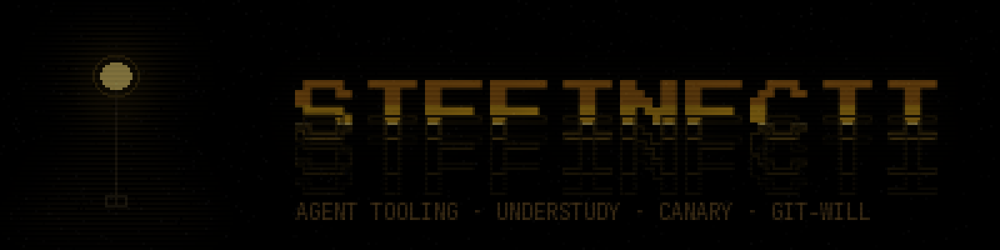

  

 

  

---

### shipped

| | |
|---|---|
| **[understudy](https://github.com/stffinfcti/understudy)** | auditions cheaper models on your real hermes history before you switch — in the official plugin catalog |
| **[canary](https://github.com/stffinfcti/canary)** | try a few first, then do the rest. an agent skill that samples your items, learns your edits, holds back what doesn't match |
| **[git-will](https://github.com/stffinfcti/git-will)** | write the will for your repo — ownership, bus factor, a succession plan for whoever's next |
| **[publish-preflight](https://github.com/stffinfcti/publish-preflight)** | smoke-test the packed npm tarball before it ships. fail the publish, not your users |

 

  
  

  

 

<picture>
  <source media="(prefers-color-scheme: dark)" srcset="https://raw.githubusercontent.com/stffinfcti/stffinfcti/output/github-snake-dark.svg" />
  <source media="(prefers-color-scheme: light)" srcset="https://raw.githubusercontent.com/stffinfcti/stffinfcti/output/github-snake.svg" />
  
</picture>

   
  i &lt;3 agents · uptime ~5,844 days · zero crashes  
  <a href="https://x.com/stffinfcti">x</a> · <a href="https://github.com/stffinfcti/understudy">understudy</a> · <a href="https://github.com/stffinfcti?tab=repositories">everything else</a>

